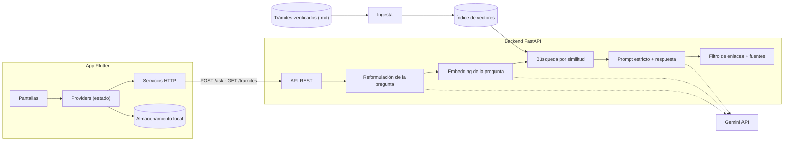

# UniTrámite

Asistente de trámites de la Universidad de Nariño: una app móvil en Flutter donde el estudiante pregunta con sus palabras y recibe una respuesta **basada solo en información oficial verificada**, con los enlaces a las fuentes de donde sale cada dato.

Proyecto final de la electiva *Desarrollo de Aplicaciones Móviles* (Ingeniería de Sistemas, Universidad de Nariño).

**Autores:** Cristian Mateo Rodríguez Solarte y Emerson Steven Imbajoa Imbajoa.

## Qué hace

- **Asistente con IA (RAG):** responde preguntas en lenguaje natural sobre 7 trámites: constancias, opción de grado, homologación, solicitud de grado, cancelación de semestre, reingreso y reserva de cupo. Si la información no está en los trámites, lo dice en vez de inventar.
- **Catálogo de trámites:** requisitos, pasos, condiciones, costos de referencia y fuentes oficiales, sin necesidad de IA.
- **Mis trámites:** el estudiante inicia un trámite y marca los pasos que ya hizo; el progreso se guarda en el dispositivo.
- **Historial:** las conversaciones se guardan localmente y se pueden retomar con su contexto.
- **Enlaces clicables** a los formularios y páginas oficiales.

## Arquitectura



Más detalle en [docs/ARQUITECTURA.md](docs/ARQUITECTURA.md).

## Cómo funciona el RAG

1. **Ingesta (una vez):** `scripts.ingest` lee cada trámite en Markdown, lo valida, lo divide en fragmentos por sección y genera un *embedding* (vector de 768 números) de cada uno con Gemini. Todo se guarda en `backend/storage/index.json`.
2. **Pregunta:** la app envía la pregunta y los últimos mensajes de la conversación.
3. **Reformulación:** si hay conversación previa, la IA reescribe la pregunta para que se entienda sola ("¿y cuánto cuesta?" pasa a decir de qué trámite habla).
4. **Búsqueda:** se calcula el embedding de la pregunta y su similitud con cada fragmento. Se eligen los trámites más cercanos. Si ninguno supera el umbral (0,60), no se consulta a la IA y se responde que no hay información.
5. **Respuesta:** la IA recibe los trámites completos y reglas estrictas: responder solo con ese contexto, no confirmar casos particulares que no estén documentados, y devolver un JSON con `found`, `answer` y `used_ids`.
6. **Control:** se eliminan los enlaces que no estén en los trámites y se arman las fuentes a partir de los trámites realmente usados.

## Estructura del repositorio

```
unitramite/
├── app/                      # App Flutter
│   └── lib/
│       ├── core/             # tema, constantes, utilidades
│       ├── models/           # modelos de datos
│       ├── providers/        # estado (Provider)
│       ├── services/         # acceso al backend y almacenamiento local
│       ├── screens/          # pantallas
│       └── widgets/          # componentes reutilizables
├── backend/
│   ├── app/
│   │   ├── rag/              # carga de trámites, embeddings, búsqueda y respuesta
│   │   ├── services/         # cliente de Gemini con reintentos y respaldo
│   │   ├── main.py           # API (FastAPI)
│   │   └── schemas.py
│   ├── data/docs/            # trámites verificados (Markdown)
│   ├── scripts/              # ingesta y evaluaciones
│   └── requirements.txt
└── docs/                     # arquitectura y evaluación
```

## Requisitos

- Python 3.10 o superior (probado con 3.12)
- Flutter (canal stable, probado con 3.47)
- Git
- Una API key gratuita de Gemini: https://aistudio.google.com/apikey
- Para el emulador: Android Studio con un dispositivo virtual creado

## Cómo ejecutarlo

### 1. Backend

En PowerShell:

```powershell
cd backend
python -m venv .venv
.\.venv\Scripts\Activate.ps1
pip install -r requirements.txt
copy .env.example .env
```

Abre `backend\.env` y pon tu clave en `GEMINI_API_KEY` (sin comillas). Luego genera el índice y arranca el servidor:

```powershell
python -m scripts.ingest
uvicorn app.main:app --reload --port 8000
```

El índice se genera una sola vez (y cada vez que cambien los trámites). Comprueba que funciona abriendo http://127.0.0.1:8000/docs.

### 2. App en Chrome

Con el backend corriendo, en otra terminal:

```powershell
cd app
flutter pub get
flutter run -d chrome
```

### 3. App en el emulador de Android

Inicia el dispositivo virtual desde Android Studio (Device Manager). Con el backend corriendo:

```powershell
cd app
flutter pub get
flutter devices
flutter run -d emulator-5554 --dart-define=API_BASE_URL=http://10.0.2.2:8000
```

Cambia `emulator-5554` por el id que muestre `flutter devices`. Dentro del emulador, `10.0.2.2` es la dirección del computador que lo aloja; por eso se usa en vez de `127.0.0.1`. Para una grabación más fluida, agrega `--release` al comando.

### 4. App en un celular real por USB

```powershell
adb reverse tcp:8000 tcp:8000
cd app
flutter run -d ID_DEL_CELULAR
```

## Variables de entorno (`backend/.env`)

| Variable | Para qué sirve | Valor por defecto |
|---|---|---|
| `GEMINI_API_KEY` | Clave de la API de Gemini (obligatoria) | — |
| `GEMINI_MODEL` | Modelo principal de generación | `gemini-3.5-flash-lite` |
| `GEMINI_FALLBACK_MODELS` | Modelos de respaldo, separados por coma | — |
| `GEMINI_EMBEDDING_MODEL` | Modelo de embeddings | `gemini-embedding-001` |
| `GEMINI_EMBEDDING_DIM` | Dimensiones del vector | `768` |
| `GEMINI_TIMEOUT_SECONDS` | Espera máxima por llamada | `15` |
| `GEMINI_TOTAL_BUDGET_SECONDS` | Tiempo total máximo, sumando reintentos | `40` |
| `RAG_MIN_SIMILARITY` | Umbral mínimo de similitud | `0.60` |
| `RAG_SCORE_MARGIN` | Margen para incluir trámites cercanos al mejor | `0.05` |
| `RAG_MAX_DOCS` | Máximo de trámites enviados a la IA | `3` |

La clave vive solo en `backend/.env`, que no se sube al repositorio. La app móvil nunca la conoce: todas las llamadas a la IA pasan por el backend.

## Pruebas y evaluación

Desde `backend`, con el entorno virtual activo:

```powershell
python -m scripts.eval_retrieval    # ¿la búsqueda encuentra el trámite correcto?
python -m scripts.eval_answers --all # respuestas de punta a punta y rechazo de preguntas ajenas
python -m scripts.eval_real         # preguntas en lenguaje informal
python -m scripts.eval_followups    # preguntas de seguimiento
python -m scripts.check_intents     # cada pregunta que promete un trámite tiene respuesta
```

Resultados y hallazgos en [docs/EVALUACION.md](docs/EVALUACION.md).

## Decisiones de diseño

- **RAG en vez de un chatbot general:** un modelo general responde con lo que recuerda, que puede estar desactualizado. Aquí responde solo con trámites que verificamos en las fuentes oficiales.
- **Trámites en Markdown:** cada uno es un archivo legible por una persona, con sus fuentes. Un validador avisa de errores de formato.
- **Similitud con NumPy en vez de una base vectorial:** con pocas decenas de fragmentos no hace falta FAISS; es más simple y fácil de explicar.
- **Umbral bajo (0,60) y rechazo por prompt:** un umbral alto descartaba preguntas legítimas. Filtra lo evidentemente ajeno y deja que la IA rechace lo cercano que no está cubierto.
- **Reformulación de la pregunta:** permite preguntas de seguimiento ("¿y cuánto cuesta?").
- **Resiliencia:** reintentos, modelos de respaldo, límite de tiempo total y mensajes de error claros en la app.
- **Fuentes verificadas:** los enlaces de la respuesta se comparan con los de los trámites; los que no existan se eliminan.

## Limitaciones

- Cubre 7 trámites, verificados el 27 de octubre de 2026. Los procedimientos, costos y fechas pueden cambiar.
- El nivel gratuito de Gemini puede saturarse en horas de mucha demanda, y Google puede usar lo que se envía para mejorar sus productos: no escribas datos personales en las preguntas.
- Orienta sobre cómo hacer los trámites, pero no los ejecuta dentro de los sistemas de la universidad.
- La conexión con el backend usa HTTP simple porque es una demostración local. Para producción haría falta HTTPS, un servidor desplegado y autenticación.

## Cómo agregar un trámite

1. Crea un archivo `.md` en `backend/data/docs/` con el mismo formato de los existentes: encabezado con `id`, `nombre`, `categoria`, `estado`, `dependencia_responsable`, `fecha_verificacion` y `contacto`, y las secciones `Intenciones`, `Descripción sencilla`, `Requisitos`, `Pasos`, `Condiciones importantes`, `Información susceptible a cambios`, `Dependencia responsable`, `Fuentes oficiales` y `Preguntas de prueba`.
2. Ejecuta `python -m scripts.ingest`: valida el archivo, avisa de errores y regenera el índice.
3. Reinicia el backend. El trámite aparece solo en el catálogo y en las respuestas.