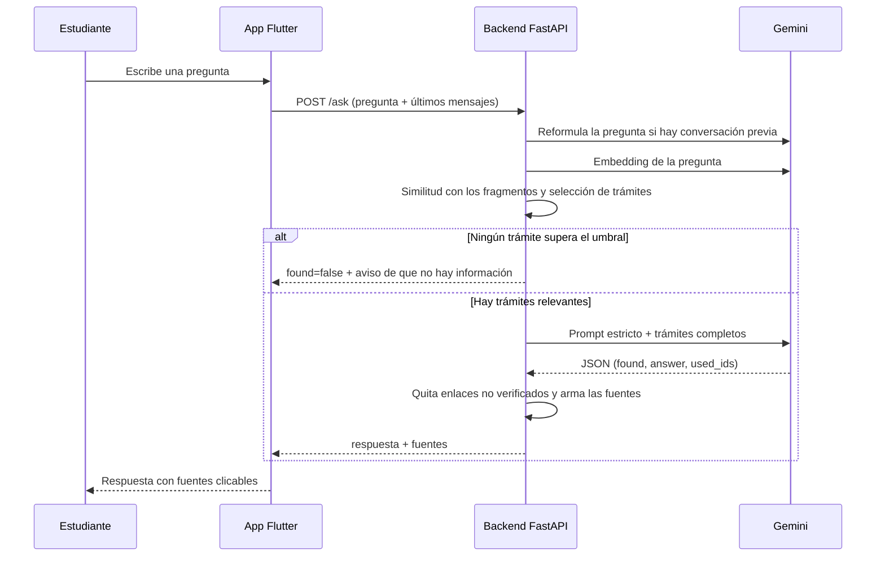
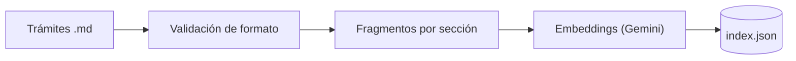

# Arquitectura de UniTrámite

## Cómo se comunica la app con la IA

La app Flutter **nunca habla directamente con la IA**. Habla con un backend propio (FastAPI), que busca en los trámites, arma el contexto y consulta a Gemini. Así la clave de la API queda en el servidor y la respuesta se controla antes de llegar al estudiante.

## Componentes

| Capa | Pieza | Responsabilidad |
|---|---|---|
| App | `screens/` y `widgets/` | Interfaz: inicio, chat, detalle de trámite, Mis trámites e historial |
| App | `providers/` | Estado de la app (Provider): chat, catálogo y progreso |
| App | `services/` | Llamadas HTTP al backend y almacenamiento local en el dispositivo |
| Backend | `main.py` | Endpoints: `GET /health`, `GET /tramites`, `GET /tramites/{id}`, `POST /ask` |
| Backend | `rag/loader.py` | Lee y valida los trámites en Markdown, y los divide en fragmentos |
| Backend | `rag/embeddings.py` | Genera embeddings con Gemini y los normaliza |
| Backend | `rag/retriever.py` | Calcula la similitud y elige los trámites relevantes |
| Backend | `rag/answering.py` | Reformula la pregunta, arma el prompt, interpreta la respuesta y filtra enlaces |
| Backend | `services/llm.py` | Llama a Gemini con reintentos, modelos de respaldo y límite de tiempo |
| Datos | `data/docs/*.md` | Los trámites verificados, con sus fuentes oficiales |
| Datos | `storage/index.json` | Índice generado por la ingesta (no se sube al repositorio) |

## Flujo de la ingesta

La ingesta no indexa las "Preguntas de prueba": son el examen del sistema, y si se indexaran, la búsqueda tendría las respuestas a la vista.

## Qué se guarda y dónde

- **En el dispositivo:** historial de conversaciones y progreso de los trámites (almacenamiento local).
- **En el backend:** los trámites y el índice de vectores. No se guardan preguntas ni datos de los estudiantes.
- **En Gemini:** solo se envían el texto de la pregunta, los últimos mensajes de la conversación y los trámites relevantes.